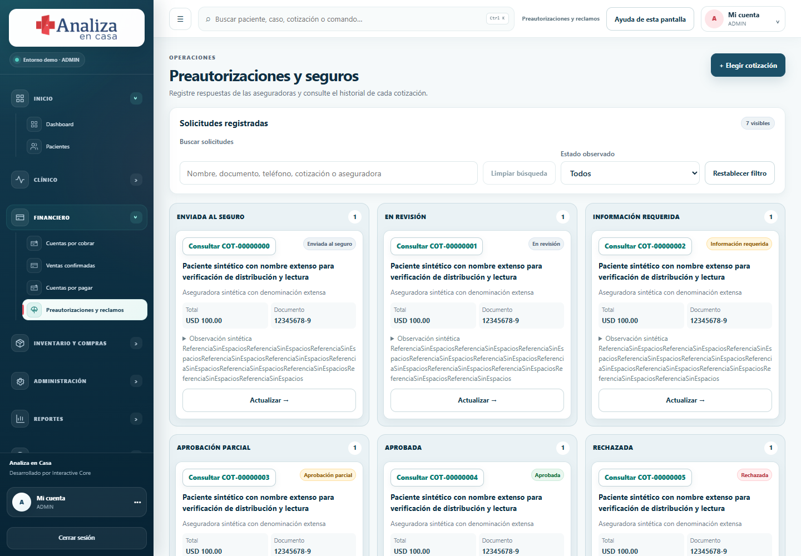

# Revisión de facturación y capturas del 4 de noviembre

Fuente conservada en `../qa/sources/CLIENT_BILLING_REVIEW_2026-11-04.txt`.

## Correcciones

- Seguros: tarjetas legibles en una, dos, tres o seis columnas según el espacio disponible; nombres, identificadores y botones permanecen dentro de su tarjeta. Código corto de cotización con identificador completo disponible al consultar.
- Médicos: eliminado el aviso técnico amarillo sobre Mongo y almacenamiento de adjuntos. Antes aparecía a los usuarios con acceso a esa pantalla. Se conserva el aviso del entorno de demostración.
- Cierre de sesión: un solo texto, «Cerrar sesión».
- Cuenta de cotización: detalle, lista y Cuentas por cobrar usan la última versión enviada y los pagos de toda su cadena. Ejemplo sintético: v1=100, abono=40, v2=120; saldo actual=80 en todas las pantallas. El documento histórico conserva su total=100 y explica la diferencia entre versión y cuenta.
- Reintento de pago: conserva ID, fecha y clave de idempotencia cuando se pierde la respuesta, incluso al cerrar y reabrir el diálogo. Cambiar un pago ya aplicado con la misma clave sigue rechazándose.
- Importes nuevos: máximo dos decimales, mínimo 0.01 y referencia de reserva obligatoria para cheque. Los registros históricos siguen siendo legibles; el cálculo agrega cada pago en centavos, como el libro PostgreSQL.
- Versiones: no se puede cambiar paciente, caso, número de versión, raíz, origen o fecha de creación al editar un borrador. Las revisiones continúan por su flujo específico y las enviadas permanecen inmutables.
- Seguro: se usa el pagador de la cotización; una cuenta particular/empresa no entra por tener el paciente una aseguradora. Las solicitudes existentes conservan su aseguradora registrada. La fecha inicial del formulario respeta la hora local.
- Reporte y CSV: los pagos históricos también se suman/redondean por centavos, tanto aplicados como reversados.
- Regresión adicional: el menú de acciones clínicas heredaba posicionamiento y recorte de estilos antiguos. Se separó el botón del contenedor desplazable; Historia clínica vuelve a ser seleccionable sin controles superpuestos.

## Verificación técnica

Preflight aprobado; 331 pruebas unitarias en 67 archivos; seis grupos PostgreSQL con rol restringido, RLS y datos exclusivamente sintéticos aprobados. Incluyen concurrencia, reintentos, sobrepago, centavos, límites por rol/organización, revisiones, reversión auditada y aseguradora. Tablero poblado sin desbordamiento en 320, 390, 768, 1024, 1440 y 1600 px.

Regresión amplia: 234 aprobadas, una omitida; tres fallos investigados (hidratación inicial transitoria del acceso, selector de enlace desactualizado y menú clínico recortado). La repetición final de los seis archivos afectados pasó 61/61, incluyendo los tres casos. Revisión de todas las rutas en 1440 y 390 px, seis roles, permisos, descuentos por categorías, lectura/escritura de cotizaciones, recibos PDF, reversión y reporte.

Pruebas conectadas: 2/2 aprobadas sobre imagen `690d680df844d538030b07e09314df82b22bb169`, base PostgreSQL temporal independiente. Una respuesta HTTP 503 se simuló DESPUÉS del commit de un pago; cerrar/reabrir/reintentar conservó el payload completo, un solo pago y el saldo correcto. También se verificaron CSRF, centavos, entidad ajena, aviso de médicos y cierre de sesión. Los ajustes posteriores son reporte/CSV, menú clínico y evidencias; los cubren las pruebas unitarias y los 61 casos finales.

Otros controles: 144/144 pruebas Node, 76/76 QA, compilación Next y standalone, TypeScript, ESLint, formato y escaneo de secretos aprobados. Revisión equivalente de los archivos financieros contra `origin/main` y el lote anterior: validación de entradas, aislamiento, auditoría, versiones y reintentos revisados; sin hallazgos P0/P1 pendientes dentro de este lote. Revisión React aplicada a hooks, estados de envío, formularios, imports y componentes compartidos.

Logs locales fuera de Git: `C:/Temp/analiza-billing-postgres.log`, `analiza-billing-connected-final.log`, `analiza-billing-unit-final.log`, `analiza-billing-check3.log`, `analiza-billing-regression.log`, `analiza-billing-focused-final.log`, `analiza-billing-visual-final.log`. La publicación y comprobación pública se agregan después del despliegue.

## Evidencia histórica y límites

Implementación final: `fdd7f0e771e8598be6eddbabba6b187be7301b7d`. Las matrices conservan las 32 solicitudes y los 210 requisitos históricos con sus estados; se añade este lote y se renuevan las huellas de regresión, sin promociones a EXACT.

[Captura móvil con datos sintéticos](evidence/billing-20261104/insurance-mobile.png).

Revisión de lectura de evidencia financiera: CH08-E0087 (00:19:52.000, resumen y saldo), CH08-E0056 (00:18:06.200, acciones de pagos) y CH16-E0018 (00:50:18.200, descuento por categoría). Archivos bajo los capítulos CH08 y CH16 de `references/video-audit/`, intactos. No se declara una nueva revisión completa de los 17 capítulos ni se eleva ningún requisito a EXACT.

Los porcentajes y responsabilidades de aseguradora siguen capturados por el equipo. No se inventaron reglas de reembolso/crédito cuando una revisión queda por debajo de lo pagado, corte contable ni integración fiscal. Los PDF son comprobantes internos no fiscales. Se mantienen abiertos los límites previamente documentados CH08-Q001/Q003/Q004/Q006 y CH07-Q008/Q009.

## Reproducir las pruebas

`npm run test:react` y `npm run test:browser:react` verifican lógica y la compilación demo. Para PostgreSQL aislado: preparar una base temporal con `scripts/prepare-clinical-postgres-qa.mjs`, cargar sus variables privadas fuera de Git y ejecutar `npm run test:billing:postgres`. Guardar su resultado con `BILLING_QA_RESULT`. `npm run test:billing:browser` exige `ANALIZA_QA_MODE=1`, `PGDATABASE=analiza_qa`, `PGHOST=127.0.0.1` y el túnel exclusivo 55440 a la web de QA, nunca a la base activa.
