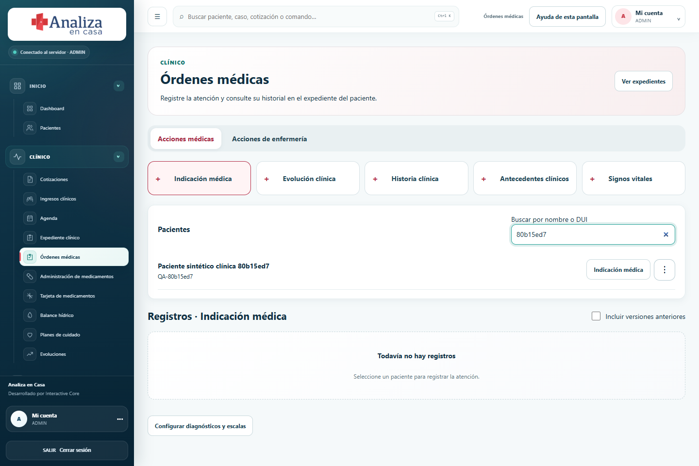
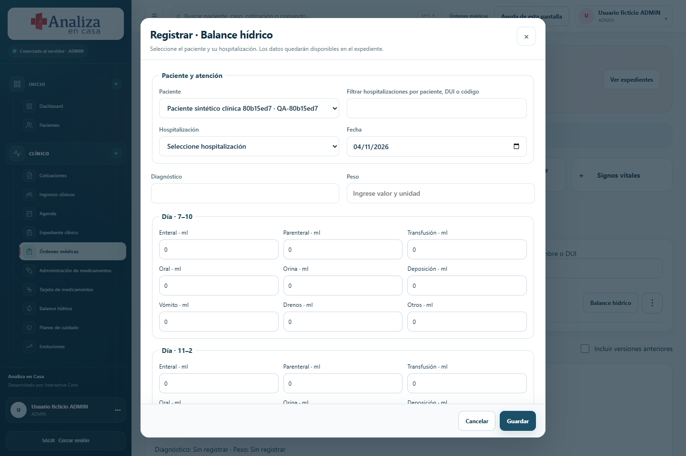

# Clinical restructure — implementation and verification ledger

Source: client-authorized `analizaencasa31oct_.pdf`, 12 pages, SHA256 `38528620ea90f313a4b4de8ba88c7cba1aeec5a3a0e7f75c087578fd8022c65b`. Source stays outside Git. Screenshot and Nov 3 instruction authorize staff-entered configuration instead of historical blanket blockers. All pages were rendered and inspected. New video review was explicitly withdrawn by the user.

Status: DEPLOYED AND VERIFIED on Contabo, release `fc7e4c6206e1f4b01f6e24ad4395d88b8a816640`. No new EXACT certification claimed.

| Requirement | Source | Implementation / acceptance |
|---|---|---|
| Clinical navigation: quotes, admissions, agenda, record, orders | p1 | Preserve old deep links; new primary hierarchy |
| Record: summary, medical, nursing, visits, full record | p1 | Patient/case isolation; quotes, new and legacy records; print each tab/one nursing record/all; recent filter |
| Orders: medical/nursing actions; all patients and name/DUI search | p1–2 | Replace disabled selector; explicit forms; no active/inactive KPI cards |
| Indication, evolution, history, background | p2 | Patient, hospitalization, date, manual summary; append-only corrections with author/reason |
| Medication card | p2 | Quote medicines plus manual chronic medicines; versioned edits, view and print |
| Fluid balance | p2–3 | Six day/night rows; 4 intake/5 output columns; manual endogenous/insensible inputs; arithmetic totals |
| Care plans | p3 | Diet/nursing text; labs from selected quote; record feed |
| Administration | p3–4 | Manual dose/presentation/route/time; applied/not applied/reason; stock consumed once; chronic excluded |
| Returns | p4 | Not-applied medicines appear in report and receivables; review revises quote without changing sent versions |
| Vitals | p4 | Time, heart/respiratory rate, oxygen, temperature, pressure, HGT; add rows |
| Nursing notes | p4 | Time, note; JVPE resolved from authenticated user's profile |
| Scales | p5–12 | EVA, Glasgow, Ramsay, ECOG, ESAS, Karnofsky, Downton, Braden, Norton, Barthel; source version snapshot, numeric selection |
| Diagnosis catalog and quote selector | p5 | 22 supplied entries, staff additions and scale associations; unmapped diagnosis shows all scales |
| User-entered missing definitions and discounts | Nov3 message | Staff may configure/upload definitions; no invented rates/doses; tenant-scoped audit |

Implementation decisions:

- Inventory source and units per application belong in the editable medication card. They are not inferred from dose and do not reappear as quantity/warehouse fields in the administration form. Stock is consumed transactionally using released, unexpired lots where applicable.
- The card retains optional manual instructions for dose, schedules, start, duration and dilution seen in CH10. New PDF explicitly replaces old navigation and summary indicators.
- Scale inputs and score arithmetic reproduce the supplied annex. ESAS remains a profile without an invented aggregate. Braden's supplied classification omits scores 12 and 19; classification is not guessed. Staff can version their definitions. These are recorded assessments, not automated treatment recommendations.
- Legacy documents and vitals remain visible with their provenance. Historical signed documents retain their signing/correction workflow. New records are append-only, including corrections.
- Missing JVPE is visibly identified and can be completed in the profile; no number is fabricated or accepted from a note payload.
- UI references: W3C form grouping (https://www.w3.org/WAI/tutorials/forms/grouping/), GOV.UK checkbox guidance (https://design-system.service.gov.uk/components/checkboxes/), W3C reduced motion (https://www.w3.org/WAI/WCAG21/Understanding/animation-from-interactions).

Baseline: repository preflight PASS; React suite 284 tests / 65 files PASS. Focused legacy evidence reviewed by read-only agent: CH10-E0013, CH10-E0050, CH17-E0038, CH17-E0043 and CH17 safety contact sheet 005. This is not a full video re-audit.

Required verification: persistence after reload; cross-tenant rejection; concurrent/retried consumption; no stock change for non-applied/chronic; versions/correction races; JVPE spoof rejection; scales min/max/incomplete/version; print isolation; mobile/keyboard/reduced motion; existing regression and client/video gates. Verification results and release SHA will be appended after execution.

Phase 1 verification (before isolated PostgreSQL verification): TypeScript, lint, production build, security scan, 299 React/unit tests, 144 Node tests, 76 QA checks and video audit integrity passed. Nine new browser tests passed in demo mode: forms for every action, all ten scale scores, 1440/390px layouts, and authorized configuration access for five staff roles. These browser checks do not prove database persistence. `scripts/verify-clinical-postgres.ts` adds isolated database tests and remains to be executed. Production remains on the previous release.

Phase 2 database verification: PASS, ten assertion groups with 30 persisted clinical records in an isolated temporary PostgreSQL instance. No production data was copied. This verifies all ten scale scores, all staff roles saving category discount profiles, scale version changes and stale-form rejection, server-resolved JVPE, lab snapshots, append-only corrections, tenant isolation and fail-closed RLS, concurrent idempotent administrations, nonnegative balances, released/unexpired FEFO lot selection, and no financial mutation for chronic or non-applied medicines. The sent quote remained unchanged. Repeated migrations passed before fixtures were created.

Regression findings addressed: patient search again normalizes DUI separators and accents; historical case links open the corresponding new record section; old readings without case IDs remain visible in the patient-wide record without being attributed to a case; legacy pulse values and signed-document workflows remain accessible. Each patient's actions menu and per-medicine administration choices follow the new PDF. Mobile controls wrap long labels. Printing uses a separate clone of the selected section, excluding navigation and hidden page layout. Scale editors tolerate unfinished text while saving still requires a valid versioned definition.

VPS read-only inspection, 2026-11-04 06:10 UTC: public application and database healthy; no failed systemd units; disk 20/193 GB (11%); approximately 10.8 GB RAM available; no reboot-required marker. Nineteen package updates remain, including Docker/containerd. No OS upgrade or daemon restart was performed as part of these clinical changes. Application release still awaits completion of browser verification and the Git-first deployment gate.

## Final verification before release

Tested application commit: `bebe3f6b4697a74be3c1a574207f65fdde743552`, pushed and verified on GitHub before building the isolated VPS QA image. The production instance was not used for these tests.

- React/unit regression: 299 tests in 66 files passed; Node regression: 144 passed; QA: 76 checks passed. Typecheck, lint, production builds on Windows and Linux, standalone build and secret scan passed.
- Browser regression: the last broad run passed 232 tests, skipped one and exposed two outdated CH17 assertions. The subsequent focused run passed all 29 cases, including those two, clinical actions, historical feedback, accessibility and the 55-route desktop/mobile review. This is not reported as a single clean broad run.
- PostgreSQL: the final run passed all ten assertion groups and persisted 30 records with a restricted runtime role. It used new schema-validated synthetic fixtures. Direct SQL fixture omissions discovered during integration were corrected in the test harness.
- Connected black-box browser suite: **6/6 passed in one final run** against the Linux production build colocated with its isolated database. Covered all manual forms, save/reload, nursing configuration, quote discount/revision, CSRF/tenant rejection, card corrections and full/individual printing. A configured 5% medicine discount produced USD 2.85 while the sent original remained USD 3.00. Unfinished JVPE profile edits no longer prevent saving a note; note provenance remains server-resolved.
- Full-record PDF: all 13 rendered pages inspected; no blank pages. Individual card output excludes unrelated records. Print tables fit their page and use dark text. Final synthetic UI captures below were inspected at 1440 and 390 pixels; reduced-motion rendering was also checked.
- Equivalent code review against `origin/main` and the task baseline covered new persistence, permission boundaries, immutable records/quotes, inventory allocation and correction paths. No unresolved P0/P1 issue was found in the changed scope. Existing exact-video certification and external integrations are not expanded by this review.
- Release gates: client 32/32, video traceability 210/210, CH01–CH03, JSON/CSV/certification mirror, repository preflight and 17-chapter evidence-integrity audit passed. The last secret scan checked 1,214 files. These gates validate traceability and existing evidence, not a newly performed full video re-audit.

Evidence logs are local, outside Git: `C:/Temp/analiza-nov04-postgres-final.log`, `C:/Temp/analiza-nov04-connected-final.log`, `C:/Temp/analiza-nov04-focused-browser.log`, `C:/Temp/analiza-nov03-full-browser-final.log`, `C:/Temp/analiza-nov04-react.log`, `C:/Temp/analiza-nov04-check.log`. Secrets and runtime account files are excluded.

[Mobile clinical actions capture](evidence/clinical-20261104/orders-mobile.png) · [Staff guide](GUIA_CLINICA_2026-11-04.md)

The supplied manual workflows are usable; staff supply missing rates, stock mappings and versioned scale definitions. No automated dose selection, extrapolated 24-hour balance, guessed classification intervals, financial credit or professional clinical certification is claimed. Historical requirements outside this PDF retain their residual scope in the matrices.

## Production verification

Git-first release `fc7e4c6206e1f4b01f6e24ad4395d88b8a816640` deployed on November 4. Migration 039 applied with forced RLS and append-only records; the runtime role has SELECT/INSERT on the new table. Public health returned HTTP 200 and both production containers are healthy.

`scripts/verify-clinical-release.mjs` passed all five checks: public readiness, verified synthetic organization/account, persisted clinical record with idempotent retry, staff-entered discount configuration, and twelve authenticated routes plus browser reload without JavaScript errors. Writes were limited to the existing synthetic QA organization. No main-organization patient, clinician, financial or clinical data was changed by these tests.

The isolated QA containers, network, image tags and server environment files were removed; their SSH tunnels were closed and three local ephemeral credential files deleted. Production credentials and rollback images remain available. See [deployment and maintenance evidence](../deployment/CONTABO_CLINICAL_RELEASE_2026-11-04.md).
