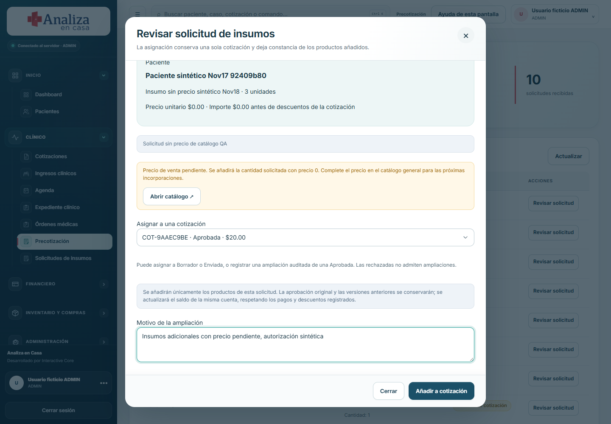
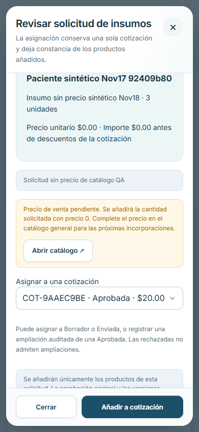

# Correcciones pendientes del 18 de noviembre

Fuente: [correcionespend_.docx, texto literal](sources/CLIENT_PENDING18_2026-11-18.txt). SHA256 `4ebe2f36e633a538466a0e7235cda380937be1ee265a0f20bde70f3c634d52d0`. Original sin imágenes, preservado. El cliente confirmó: «que salga 0 y ellas tienen que colocarle en las tablas de insumos» y después «En el catálogo general de insumos.»

Estado: publicado en Contabo después de GitHub, release `e91949373a5d94c7fdc9b1eeecf2379629d7688c`. [Despliegue y respaldo](../deployment/CONTABO_PENDING18_2026-11-18.md).

| ID | Requisito | Tratamiento |
|---|---|---|
| PEND18-01 | Responsable administrativo bloqueado | La versión publicada ya era de sólo lectura y el servidor conserva el creador. Se añade deshabilitado visual y texto explicativo; se prueba creación, recuperación de borrador, edición y revisión sin reemplazarlo. |
| PEND18-02 | Orden exacto de Clínico | Cotizaciones, Ingresos clínicos, Agenda, Expediente clínico, Órdenes médicas, Precotización y Solicitudes de insumos. Permisos por rol conservados. |
| PEND18-03 | Retirar precio por solicitud y añadir insumos una vez | Se retira el input. Precio de catálogo automático; cuando falta, cero autorizado y auditoría de precio pendiente. Una sola acción Añadir a cotización, motivo conservado, versiones inmutables, misma cuenta y pagos. Acceso al catálogo filtrado para completar el precio reutilizable. |

## Diagnóstico comprobado

La aplicación pública servía `9f8307d99ec4647d1ded9f1656c4fb9e5fddb016`. Web y PostgreSQL saludables; salud HTTP 200, disco 21%, aproximadamente 9.8 GB disponibles. La inspección autenticada de sólo lectura encontró cinco solicitudes pendientes y las cinco sin precio de venta. El diálogo público no tenía Actualizar cotizaciones ni Guardar ampliación; sí tenía una acción Añadir a cotización y el input de precio manual. No se puede atribuir con certeza el reclamo de los dos botones a una sesión/captura concreta.

La anterior solución exigía completar un precio por solicitud. Esa decisión no satisface el nuevo documento y queda sustituida por la confirmación explícita de cero. No se asumen precios de costo ni conversiones de moneda. Un precio de catálogo modificado después no reescribe cotizaciones ya emitidas; aplica a incorporaciones posteriores. Las ampliaciones anteriores conservan su importe y auditoría.

## Verificación

Preflight limpio y 382 pruebas unitarias/servidor aprobadas antes del cambio. Pruebas de integración aisladas con datos sintéticos; no se alteran solicitudes, cotizaciones ni pagos reales. Se mantienen CH01–CH03 y los estados históricos de video. Este lote no certifica una nueva revisión completa de los 17 capítulos.

Resultados y evidencia finales: [regresión](evidence/pending18-20261118/regression.json) y [conciliación pública sintética](evidence/pending18-20261118/public-financial.json).

Verificación previa a QA conectado: 382 pruebas unitarias/servidor, TypeScript, ESLint, formato y compilación mock aprobados; 13 grupos PostgreSQL y 58 escenarios mock distintos aprobados tras repeticiones. Las tres pruebas Doctor de CH14 esperaban el antiguo destino de login; se actualizaron para entrar por Clínica y navegar explícitamente a la ruta restringida. La primera repetición usó dos rutas de modal inexistentes; se corrigieron a /inventory y pasaron las tres. No se modificaron permisos para hacerlas pasar. CH01–CH03, gate de cambios 32/32, seguridad, auditoría, 144 tests legacy y 76 QA aprobados. Fingerprints CR-011/CR-012 actualizados después de la regresión sin cambiar sus estados históricos.

Consulta agregada adicional: los cinco artículos pendientes no tienen importaciones con moneda vacía/no USD. Por tanto no están sujetos al bloqueo de conciliación que se mantiene para otras fuentes importadas sin moneda confirmada.

La versión 51317f1 pasó los ocho recorridos conectados y 37 grupos PostgreSQL (13 de flujo, 18 clínicos y seis financieros). La revisión visual encontró recorte del enlace de Catálogos dentro del diálogo móvil: se cambió el aviso a una columna con botón compacto, y se añadió control de ancho interior. Se repetirá el escenario afectado sobre el nuevo SHA antes de publicar. El escenario reinicia únicamente el precio de su fixture sintética para ser repetible.

El ajuste final e919493 pasó los dos recorridos repetidos: precio pendiente/catalogación/asignación/cuenta y menú/búsqueda de pacientes. Se abrieron ambas capturas finales; el enlace ya no se recorta y los controles caben dentro del diálogo a 390 px. La prueba de catálogo cambió el precio a 7.25 y una solicitud posterior de dos unidades sumó 14.50, pasando de 20.00 a 34.50 en una sola cuenta; la versión anterior con precio 0 permaneció intacta.

En producción, la prueba pública sintética confirmó total 18.00, seguro 3.00, paciente 15.00, pago previo 5.00 y saldo 10.00; una cuenta, dos versiones y una línea de tres unidades a cero pese a dos llamadas concurrentes. Recarga, responsable deshabilitado y menú exacto verificados. La organización principal se comprobó únicamente en lectura: menú correcto, una acción Añadir, cero inputs manuales y aviso de precio pendiente. No se asignaron sus solicitudes reales. No se encontraron P0/P1 en el alcance revisado.

